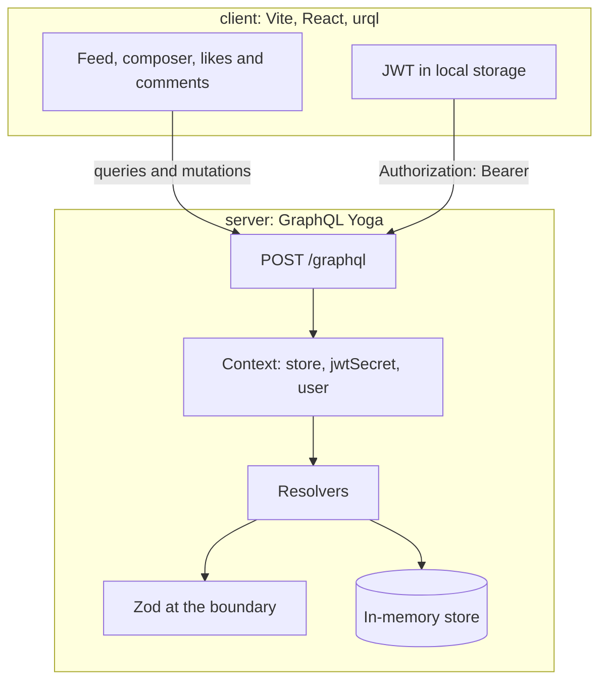

# Social Feed (GraphQL)

A small social feed built as a monorepo: a TypeScript GraphQL server and a React client. All people and posts are fictional example data.

Status: you can sign in as a seeded demo user and use the client feed, including cursor pagination and optimistic likes and comments. Persistence (SOC-06) and production deploy (SOC-07) still need Ali's go, so there is no public live site yet.

See [docs/LEARN.md](docs/LEARN.md) for how the schema, resolvers, auth context and optimistic UI work.

## Live links

Until SOC-07 is approved, run it locally:

- GraphQL API: http://localhost:4000/graphql
- Client: the Vite dev server (default http://localhost:5173), which proxies `/graphql` to the API

Planned after SOC-07: the client on GitHub Pages and the server on Render's free tier.

## Free-tier cold starts

Render's free web service sleeps after a period of idle time. The first request after that can take tens of seconds while the process starts. Until persistence is in place, the in-memory store is also empty again after every cold start (the seed is reloaded, but anything you posted in a previous session is gone). That trade-off will be explained in the client UI once the server is actually deployed. It does not apply to `npm run dev:server`, which stays up until you stop it.

## Architecture

## Layout

- `server/`: Node, TypeScript, GraphQL Yoga, tests with Vitest.
- `client/`: Vite, React 19, strict TypeScript, gloss colour scheme (Khaki, Graphite, Midnight), motion toggle (static by default), English and German.

## Run it

    npm run install:all
    npm run dev:server   # http://localhost:4000/graphql
    npm run dev:client   # Vite proxies /graphql to the server
    npm test             # server and client tests
    npm run typecheck
    npm run build

## Notes

- Themes: Khaki, Graphite and Midnight only, no high-contrast theme. Contrast tests cover text and borders in every theme. Motion stays off by default and is forced off when you prefer reduced motion.
- Desktop first; phones scroll and stay usable.
- `client/scripts/leak-guard.mjs` scans the client for terms that must not appear in a public repo (`npm --prefix client run guard`).

## Licence

MIT, see LICENSE.
